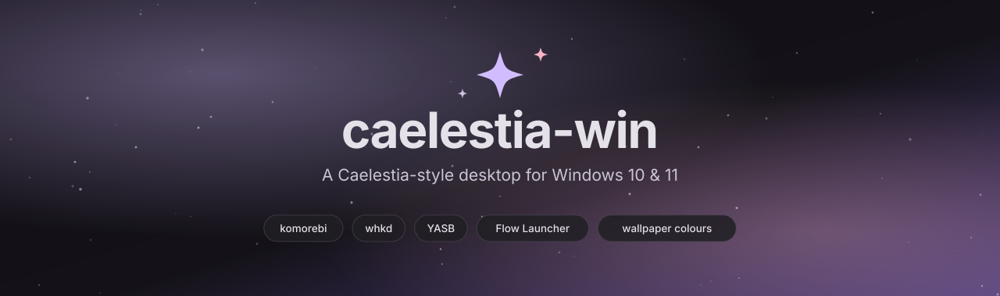
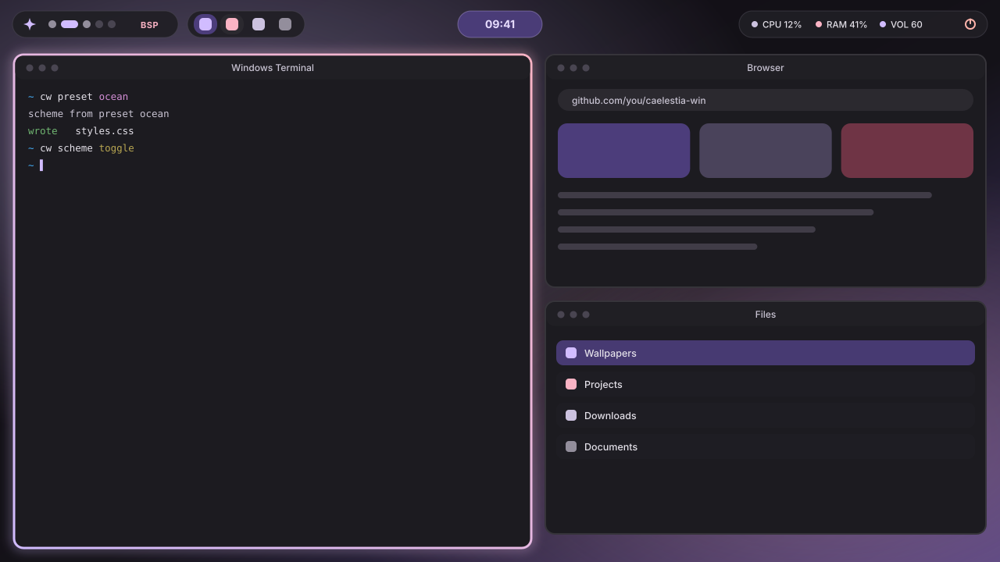
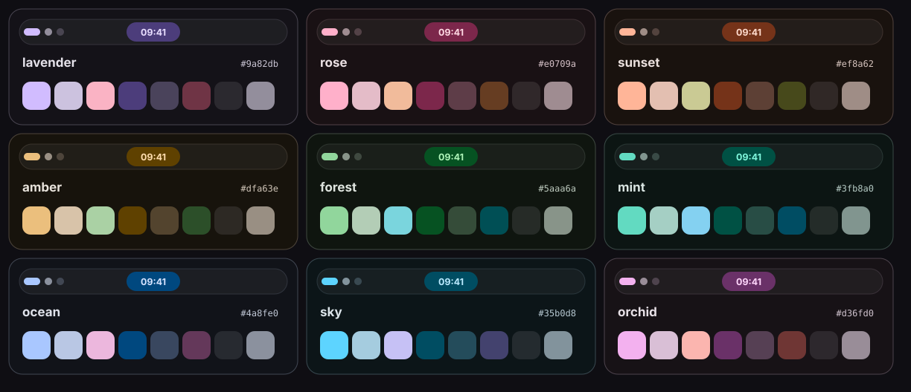
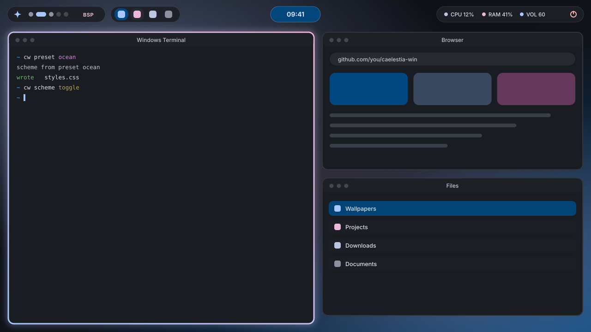
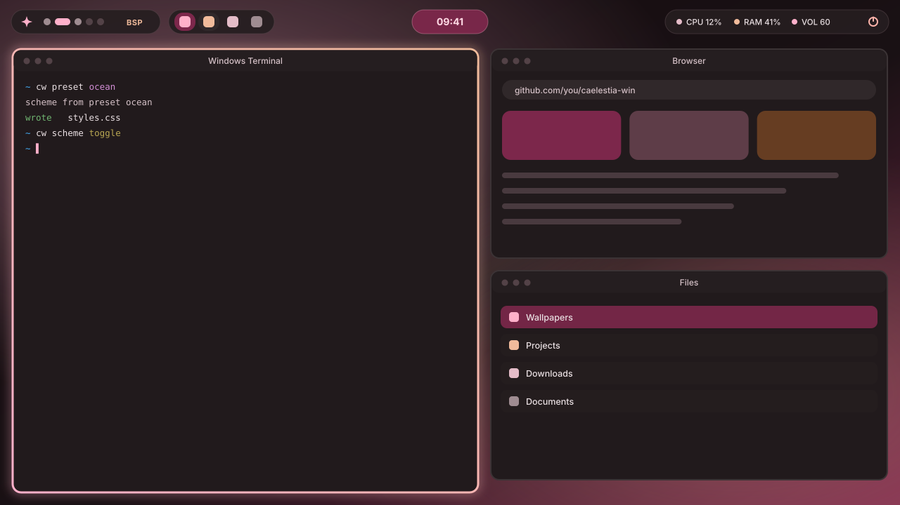
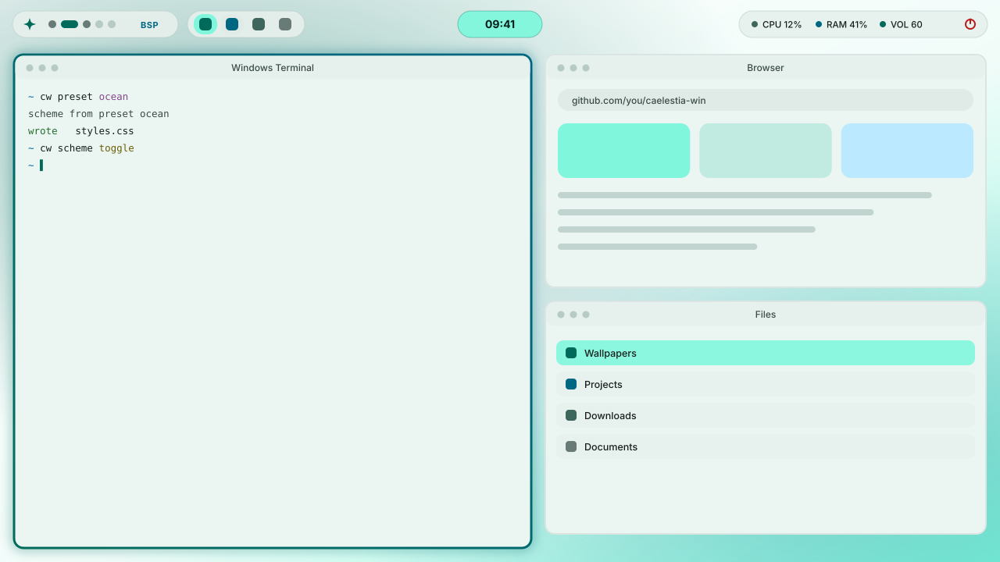
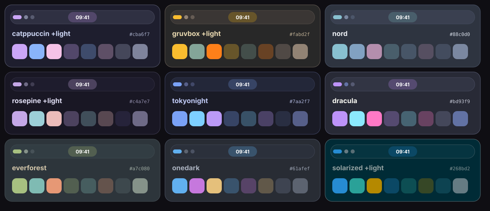
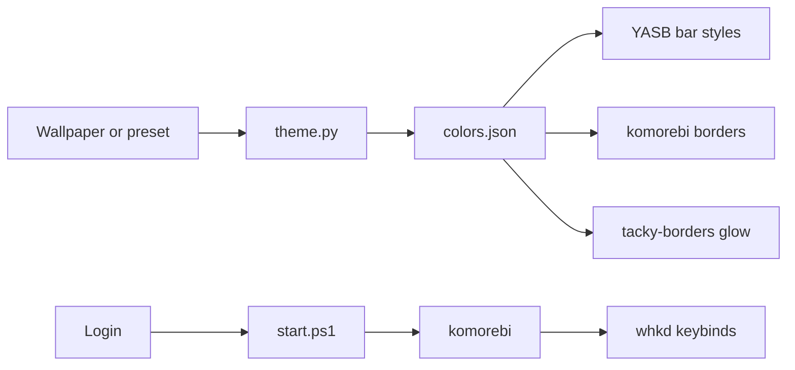

<div align="center">



<br>

[](https://github.com/krvats/caelestia-win/actions)
[](LICENSE)
[](#requirements)
[](https://github.com/krvats/caelestia-win/releases)

**Tiling. Rounded glowing borders. A floating bar that replaces the taskbar. Colours that follow your wallpaper, even a video one.**<br>
A Windows tiling window manager setup ("rice") inspired by [Caelestia](https://github.com/caelestia-dots/shell) and Hyprland, built on komorebi, YASB and whkd, installed with one command on Windows 10 and 11.

[Install](#install) &nbsp;·&nbsp; [Beginner guide](docs/GETTING-STARTED.md) &nbsp;·&nbsp; [Settings window](#settings-window-no-files-no-commands) &nbsp;·&nbsp; [Animated wallpapers](#animated-wallpapers) &nbsp;·&nbsp; [Themes](#themes) &nbsp;·&nbsp; [Keybinds](docs/KEYBINDS.md) &nbsp;·&nbsp; [Commands](#the-cw-command) &nbsp;·&nbsp; [Customize](docs/CUSTOMIZING.md) &nbsp;·&nbsp; [Troubleshooting](docs/TROUBLESHOOTING.md)

</div>

<br>

<p align="center">
  
  <br>
  <sub>Concept render drawn from the real generated palette. Real screenshots welcome, see <a href="CONTRIBUTING.md">contributing</a>.</sub>
</p>

<br>

## Why this exists

Caelestia is a gorgeous Linux desktop shell built on Hyprland and Quickshell. Neither runs on Windows, and no complete port exists. **caelestia-win** assembles the nearest equivalent from best-in-class Windows tools and adds the missing glue: a wallpaper-to-colour engine, a `cw` control command and an installer that sets it all up for you.

It runs at the desktop level, not as a window. It tiles your real apps with wide gaps and rounded gradient borders, hides the Windows taskbar and puts your running apps in a floating bar, starts at login, and uses no admin rights.

| | Caelestia on Linux | caelestia-win |
|---|---|---|
| Tiling and workspaces | Hyprland | [komorebi](https://github.com/LGUG2Z/komorebi) |
| Rounded gradient window borders + glow | Hyprland borders | [tacky-borders](https://github.com/lukeyou05/tacky-borders) |
| Keybinds | Hyprland binds | [whkd](https://github.com/LGUG2Z/whkd), Alt-based |
| Bar and running apps | Quickshell | [YASB](https://github.com/amnweb/yasb), floating pills + taskbar widget |
| Launcher | Quickshell | [Flow Launcher](https://www.flowlauncher.com/), `Alt+Space` |
| Session panel | Quickshell | YASB power menu |
| Wallpaper colours | Material You | `theme.py`, Material-style palette from the wallpaper |
| Animated (video / GIF) wallpapers | [caelestia-aw](https://github.com/AdiAmbassador/caelestia-aw) patch | [Lively Wallpaper](https://github.com/rocksdanister/lively) + FFmpeg, driven by [`cw live`](docs/ANIMATED.md) |
| Settings app | Nexus settings | [Settings window](#settings-window-no-files-no-commands), `Alt` `S` |
| `caelestia` CLI | yes | [`cw`](#the-cw-command) |

<br>

## Quick start

1. Run the installer (below), then **sign out and in once**.
2. Press `Alt` `Enter` twice: two terminals tile side by side.
3. Press `Alt` `W`: a new wallpaper, and the whole desktop recolours.
3. Press `Alt` `S` (or open **Caelestia Settings** from the Start menu): change colours, gaps, bar and shortcuts with buttons, no files needed.
4. Press `Alt` `Space` to launch apps, `Alt` `1`..`9` to switch workspaces.
5. Lost? Run `cw keys` for the cheat sheet or `cw doctor` to fix problems.

New to tiling window managers? Read the [beginner guide](docs/GETTING-STARTED.md), it needs no experience.

<p align="center">
  
</p>

<br>

## Install

**Requirements:** Windows 10 (2004+) or 11, [winget](https://learn.microsoft.com/windows/package-manager/) (included with current Windows), an internet connection. No administrator needed.

```powershell
git clone https://github.com/krvats/caelestia-win
cd caelestia-win
powershell -NoProfile -ExecutionPolicy Bypass -File .\Install.ps1
```

No git? Download the repository as a ZIP from GitHub, extract it, and **double-click `Setup.bat`**. That is the whole installation.

Then sign out and back in once so every app picks up the new font. From now on everything starts at login.

<details>
<summary><b>Installer options</b></summary>

<br>

| Flag | Effect |
|---|---|
| `-KeepTaskbar` | Leave the Windows taskbar alone. By default it is set to auto-hide (Explorer restarts once) because the bar shows your running apps. Undo any time: `cw taskbar show` |
| `-SkipBorders` | Do not download tacky-borders; komorebi's plain borders are used |
| `-SetWallpaper` | Also switch to the bundled wallpaper. Otherwise yours is kept and only used to pick colours |
| `-SkipLauncher` | Do not install Flow Launcher |
| `-SkipFont` | Do not install the Nerd Font |
| `-KeepConfigs` | Keep existing komorebi / whkd / YASB configs instead of replacing them |
| `-WithAnimated` | Also install Lively Wallpaper and FFmpeg so video and GIF wallpapers work (or add them later with `cw live install`) |
| `-NoPause` | Do not wait for Enter at the end (the window stays open by default so you can read errors) |

Anything it would replace is backed up first to `~\.config\caelestia-win\backup-<time>`. Everything it prints is also saved to `~\.config\caelestia-win\install.log`.

</details>

<details>
<summary><b>What the installer does</b></summary>

<br>

1. Checks your Windows build and that winget exists.
2. Installs komorebi, whkd, YASB, Flow Launcher, JetBrainsMono Nerd Font and Python (only if missing) through winget, and downloads tacky-borders from its GitHub releases (.exe, .zip or .msi, whichever the release ships).
3. Copies configs to `~\.config\komorebi`, `~\.config\whkd`, `~\.config\yasb`, and the tooling to `~\.config\caelestia-win`.
4. Adds the `cw` command to your user PATH and sets `KOMOREBI_CONFIG_HOME` / `WHKD_CONFIG_HOME`.
5. Installs Pillow for the user, downloads komorebi's per-app rules.
6. Generates colours from your current wallpaper.
7. Adds a login entry (`HKCU\...\Run`), a Start menu entry for the settings window, enables YASB autostart, starts everything now and auto-hides the Windows taskbar.
8. If a program is installed but "not found", looks for it in the usual folders and adds it to your PATH.

</details>

<br>

## Settings window (no files, no commands)

Press `Alt` `S`, use **Caelestia Settings** in the Start menu, or run `cw settings`.

| Page | What you can change |
|---|---|
| Colours | Theme (auto + 9 colour themes + 9 community themes), dark or light, colour style, live colour swatches |
| Wallpaper | Thumbnails of your pictures and your animated wallpapers: click to set, next, random, add files, volume, pause rules |
| Windows | Space around the screen and between windows, border thickness, default layout, animations |
| Bar | Top or bottom, height, and a tick list of every item in the bar |
| Shortcuts | A table of every keyboard shortcut: edit, add an app, delete, save |
| System | Start at sign-in, hide or show the Windows taskbar, restart, health check, open config folders |

Every button edits the same files the installer made and applies the result straight away. A copy of each file is saved to `~\.config\caelestia-win\backup-settings` first, so power users can still edit files by hand.

<br>

## Animated wallpapers

Video and GIF wallpapers, like the [caelestia-aw](https://github.com/AdiAmbassador/caelestia-aw) fork adds on Linux. [Lively Wallpaper](https://github.com/rocksdanister/lively) draws the video behind your windows; caelestia-win adds the colours, thumbnails and pause rules.

```powershell
cw live install             # one time: Lively Wallpaper + FFmpeg (or install with -WithAnimated)
# put .mp4 .webm .mkv .gif files in  ~\Pictures\Wallpapers\Animated
cw live next                # Ctrl+Alt+W; also random | prev | set <file>
cw live stop                # Ctrl+Alt+Shift+W, back to your picture wallpaper
```

| caelestia-aw feature | caelestia-win |
|---|---|
| MP4, WebM, MKV, GIF | Same, plus MOV and AVI |
| Separate "Animated" library | `Pictures\Wallpapers\Animated` and an **Animated** view in the settings window |
| Thumbnails cached by file | `cw live thumbs`, cached by name, size and date |
| Colours from a frame of the video | The whole desktop recolours from a frame (needs FFmpeg) |
| Pause on battery or fullscreen app | Both on by default, each can be switched off: `cw live rules battery off` |
| Live preview while browsing | "Preview while I click through the list" in the settings window |
| Hardware decoding choice | Lively settings, opened by `cw live settings` |

More in [docs/ANIMATED.md](docs/ANIMATED.md).

<br>

## Themes

Colours come from your wallpaper by default. Prefer a fixed look? Pick a preset:

```powershell
cw preset ocean      # lavender · rose · sunset · amber · forest · mint · sky · ocean · orchid
cw preset auto       # back to following the wallpaper
cw scheme toggle     # dark / light
cw variant vibrant   # tonal · vibrant · muted · mono
```

<p align="center">
  
</p>

<table>
  <tr>
    <td width="50%"></td>
    <td width="50%"></td>
  </tr>
  <tr>
    <td align="center"><sub><code>cw preset ocean</code></sub></td>
    <td align="center"><sub><code>cw preset rose</code></sub></td>
  </tr>
  <tr>
    <td colspan="2"></td>
  </tr>
  <tr>
    <td colspan="2" align="center"><sub><code>cw preset mint</code> + <code>cw scheme light</code></sub></td>
  </tr>
</table>

### Community themes

Prefer a palette you already know? These fixed colour schemes recolour the bar, the borders and the terminal scheme exactly like the presets above:

```powershell
cw preset catppuccin   # catppuccin (+ light) · gruvbox (+ light) · rosepine (+ light) · solarized (+ light)
cw preset nord         # nord · tokyonight · dracula · everforest · onedark
cw scheme light        # catppuccin latte, gruvbox light, rose pine dawn, solarized light
```

<p align="center">
  
</p>

The colour values are the published palettes of Catppuccin, Gruvbox, Nord, Rosé Pine, Tokyo Night, Dracula, Everforest, One Dark and Solarized; the names belong to their authors. A theme without a light variant keeps its dark look.

Every theme change recolours the bar and the window borders live (the border gradient runs from the primary to the tertiary colour). Windows Terminal gets a matching scheme file you can paste in ([how](docs/CUSTOMIZING.md#windows-terminal)).

<br>

## Keybinds

Windows reserves most `Win` combinations, so **Alt** is the main modifier. The full list, Windows Terminal and Flow Launcher tips and a habit guide are in [docs/KEYBINDS.md](docs/KEYBINDS.md).

| Keys | Action | | Keys | Action |
|---|---|---|---|---|
| `Alt` `Enter` | Terminal | | `Alt` `1`…`9` | Go to workspace |
| `Alt` `Space` | Launcher | | `Alt` `Shift` `1`…`9` | Send window to workspace |
| `Alt` `E` / `B` / `P` | Explorer / browser / screenshot | | `Alt` `T` | Toggle floating |
| `Alt` `Q` | Close window | | `Alt` `F` | Maximise |
| `Alt` `H J K L` | Focus window | | `Alt` `Shift` `F` | Monocle |
| `Alt` `Shift` `H J K L` | Move window | | `Alt` `=` / `-` | Resize wider / narrower |
| `Alt` `Shift` `Enter` | Promote to main | | `Alt` `Shift` `=` / `-` | Resize taller / shorter |
| `Alt` `W` | Next wallpaper and colours | | `Alt` `X` / `Y` | Flip layout |
| `Alt` `Shift` `W` | Random wallpaper | | `Alt` `Arrows` | Stack windows as tabs |
| `Alt` `Shift` `T` | Dark / light | | `Alt` `;` `[` `]` | Unstack, cycle tabs |
| `Alt` `Shift` `O` | Reload config | | `Ctrl` `Alt` `L` | Lock |
| `Alt` `S` | Settings window | | `Ctrl` `Alt` `W` | Next animated wallpaper |

Everything lives in `~\.config\whkd\whkdrc`. Edit, then press `Alt` `Shift` `O`.

Put wallpapers in `~\Pictures\Wallpapers`. `Alt` `W` cycles through them and recolours everything. Animated ones go in `Wallpapers\Animated` and use `Ctrl` `Alt` `W`.

<br>

## The `cw` command

Open a new terminal after installing.

```text
cw wallpaper next | prev | random | set <file> | current
cw live next | prev | random | set <file> | stop | pause | resume | volume <0-100>
cw live rules battery | fullscreen on | off
cw live list | thumbs | status | install | settings
cw settings           open the settings window
cw preset <name> | auto | list
cw scheme dark | light | toggle
cw variant tonal | vibrant | muted | mono
cw theme               regenerate colours now
cw reload              reload komorebi, whkd, the bar and the borders
cw start | stop | status
cw taskbar hide | show
cw lock
cw keys                print the shortcut cheat sheet
cw screenshot          save a screenshot
cw doctor              check every piece and print the fix for anything wrong
```

<br>

## How it works



```text
 wallpaper ──► theme.py ──► colors.json ──► YASB styles.css      (bar)
 (or preset)   (CIE Lab tones,             komorebi.json         (window borders)
                gamut-clipped)             terminal-scheme.json  (Windows Terminal)

 login ──► start.ps1 ──► komorebi ──► whkd (keybinds) ──► cw / komorebic actions
                         YASB (bar) ◄── komorebi workspace events
```

- **`theme.py`** reads the dominant colourful hue of an image and builds a full set of Material-style roles (primary, containers, surfaces, outlines) at fixed lightness tones, with contrast checked by the test suite. It is dependency-free apart from Pillow, and it approximates Material You rather than reproducing it exactly.
- **`styles.css`** is generated from `templates/yasb.styles.css.tmpl`, so the whole bar look is one editable template.
- Only `border_colours` is ever changed inside your `komorebi.json`.

<br>

## What changes on screen

| | Before | After |
|---|---|---|
| Windows taskbar | Always visible, bottom | Auto-hidden. Running apps are in the top bar |
| Window borders | None | Rounded gradient border with glow on the focused window, in your wallpaper colours |
| Window gaps | Windows flush against each other | 14 px around, 20 px between windows |
| Layout | Floating, overlapping windows | Tiled, with nine workspaces |
| Colours | Windows accent | Taken from your wallpaper, re-themed live |

Open a few windows after installing and press `Alt` `H J K L` to move focus. If the borders or tiling do not appear, run `cw doctor`.

<br>

## More guides

| Guide | For |
|---|---|
| [Getting started](docs/GETTING-STARTED.md) | First-time users, step by step |
| [Shortcuts and productivity](docs/KEYBINDS.md) | Every key, plus habits that make you fast |
| [Customizing](docs/CUSTOMIZING.md) | Colours, bar, gaps, rules |
| [Animated wallpapers](docs/ANIMATED.md) | Video and GIF wallpapers, pause rules, tips |
| [Screenshots](docs/SCREENSHOTS.md) | Capture and share your setup |
| [Troubleshooting](docs/TROUBLESHOOTING.md) | When something looks wrong |

<br>

## FAQ

<details>
<summary><b>Is this the real Caelestia?</b></summary>
<br>
No. Caelestia is a Linux shell and cannot run on Windows. This project recreates its look and workflow with Windows tools. It is not affiliated with the Caelestia project.
</details>

<details>
<summary><b>Does it replace the Windows shell?</b></summary>
<br>
No. Explorer keeps running, so Start, search, notifications and the lock screen keep working. komorebi tiles windows on top of it, YASB adds the bar, and you can auto-hide the taskbar with <code>cw taskbar hide</code>. Nothing is patched or injected into Windows.
</details>

<details>
<summary><b>Is it safe? Does it need admin?</b></summary>
<br>
No admin. It writes to your user profile and the <code>HKCU</code> registry only (autostart, environment variables and the taskbar auto-hide setting). The apps come from winget, except tacky-borders, an unsigned open-source executable downloaded from its GitHub releases (skip it with <code>-SkipBorders</code>; Windows SmartScreen or antivirus may ask about it). Read <code>Install.ps1</code> first, it is short. <code>Uninstall.ps1</code> reverses everything.
</details>

<details>
<summary><b>Why Alt and not the Windows key?</b></summary>
<br>
Windows reserves most <code>Win</code>+key shortcuts and cannot be overridden reliably by a user-mode tool. Alt keeps every bind dependable.
</details>

<details>
<summary><b>Why is the bar horizontal? Caelestia's is vertical.</b></summary>
<br>
YASB bars sit at the top or bottom of the screen, so this is the closest option for now.
</details>

<details>
<summary><b>Can I use my own bar, launcher or terminal?</b></summary>
<br>
Yes. Each piece is independent. Delete the YASB lines you do not want, or install with <code>-SkipLauncher</code> and use any launcher you like.
</details>

<details>
<summary><b>Something broke.</b></summary>
<br>
Run <code>cw doctor</code>, then see <a href="docs/TROUBLESHOOTING.md">troubleshooting</a>. Still stuck? <a href="https://github.com/krvats/caelestia-win/issues/new/choose">Open an issue</a> with the doctor output.
</details>

<br>

## Uninstall

```powershell
powershell -NoProfile -ExecutionPolicy Bypass -File .\Uninstall.ps1
```

Stops everything, restores the taskbar and removes autostart and the Start menu entry. Lively Wallpaper and FFmpeg (if you added them) stay installed. If komorebi borders stay off afterwards, run `komorebic border enable`. Add `-RestoreBackup` to bring back your earlier configs, `-RemoveApps` to uninstall komorebi, whkd and YASB, `-RemoveConfig` to delete the config folders.

<br>

## Known limits and status

- **Not possible with these tools:** Caelestia's vertical side bar and its curved screen-corner frame (YASB bars are horizontal, top or bottom only), hover pop-outs, dashboard drawers and blur behind windows. Windows provides the lock screen, notifications and quick settings.
- No Super-key binds.
- Colours approximate Material You, they are not bit-identical to Caelestia's.
- Flow Launcher is not recoloured automatically. The Windows Terminal scheme is a manual paste.
- No weather widget, it needs an API key. Add one in `config.yaml` if you want it.
- `optional/Build-Dashboard.ps1` builds [Krozzii/caelestia-windows](https://github.com/Krozzii/caelestia-windows), an unmaintained Qt dashboard. It is untested and not needed.
- **Testing:** the colour engine, templates and every shipped config are covered by automated tests that run in CI on Windows and Linux. The PowerShell scripts are syntax-checked in CI, but were written without access to a Windows machine, so please report anything that misbehaves with your `cw doctor` output.

<br>

## Project layout

```text
Setup.bat  Install.ps1  Uninstall.ps1
config/      komorebi.json · whkdrc · yasb/config.yaml
templates/   yasb.styles.css.tmpl · tacky-borders.config.yaml.tmpl
scripts/     cw.ps1 · settings.ps1 · settings-lib.ps1 · live-guard.ps1 · theme.py · start.ps1
wallpapers/  caelestia-default.jpg
docs/        CUSTOMIZING.md · ANIMATED.md · TROUBLESHOOTING.md · assets/
tools/       make_previews.py
tests/       test_theme.py · settings-lib.tests.ps1
optional/    Build-Dashboard.ps1
```

<br>

## Credits

Animated wallpapers are played by [Lively Wallpaper](https://github.com/rocksdanister/lively) by rocksdanister, and the feature set follows [caelestia-aw](https://github.com/AdiAmbassador/caelestia-aw) by AdiAmbassador. Built on [komorebi](https://github.com/LGUG2Z/komorebi) and [whkd](https://github.com/LGUG2Z/whkd) by LGUG2Z, [YASB](https://github.com/amnweb/yasb) by AmN, [tacky-borders](https://github.com/lukeyou05/tacky-borders) by lukeyou05 and [Flow Launcher](https://www.flowlauncher.com/). Look and feel inspired by [Caelestia](https://github.com/caelestia-dots/shell). Released under the [MIT License](LICENSE).

<div align="center"><sub>If it makes your desktop nicer, a ★ helps others find it.</sub></div>
