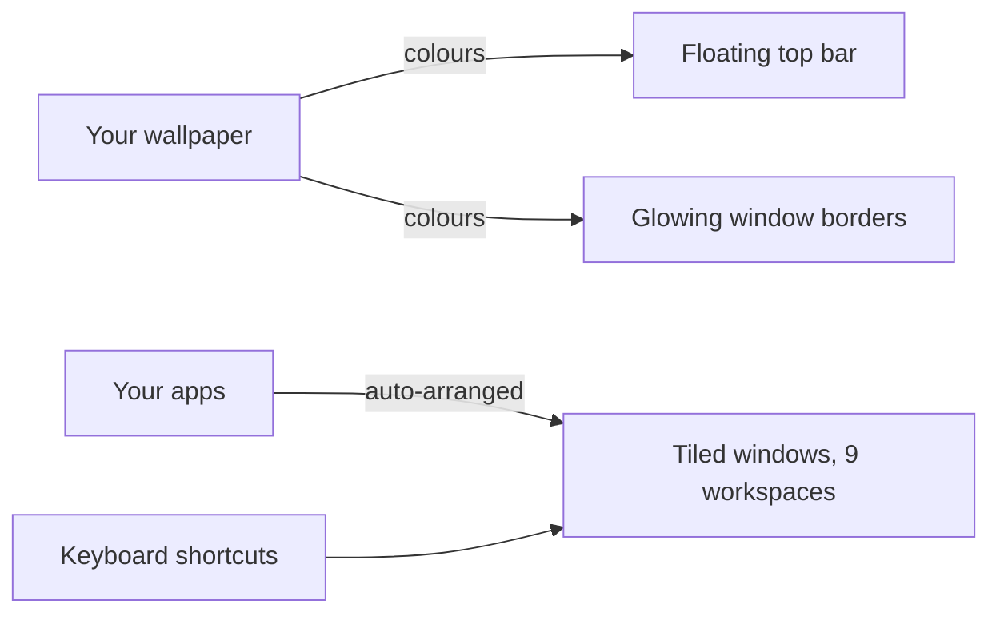

# Getting started (for everyone, no experience needed)

This guide takes you from nothing to a working tiling desktop in about 10 minutes. Nothing here needs administrator rights, and everything can be undone.

## What you are getting



- **Tiling**: windows arrange themselves side by side, so you never drag or resize by hand.
- **A top bar**: shows workspaces, running apps, time, battery, volume.
- **Colours from your wallpaper**: change the picture and the whole desktop recolours.
- **Everything by keyboard**: hold `Alt` and press a letter.

## Step 1: Install

1. Open **Start**, type `PowerShell`, press Enter.
2. Paste this and press Enter:

```powershell
git clone https://github.com/krsna0001/caelestia-win
cd caelestia-win
powershell -NoProfile -ExecutionPolicy Bypass -File .\Install.ps1
```

No git? On the GitHub page click **Code → Download ZIP**, extract it, open the folder, click the address bar, type `powershell`, press Enter, then run only the last line.

3. Wait until it prints `Done.` Yellow `WARNING` lines are not failures; each says what still works.
4. **Sign out and back in once** (this makes the font show correctly).

## Step 2: Your first five minutes

| Try this | What happens |
|---|---|
| Press `Alt` `Enter` | A terminal opens |
| Press `Alt` `Enter` again | A second window appears beside it, tiled automatically |
| Press `Alt` `H` then `Alt` `L` | Focus moves left, then right |
| Press `Alt` `Shift` `L` | The window swaps to the right |
| Press `Alt` `2` | You jump to an empty workspace 2 |
| Press `Alt` `1` | You are back |
| Press `Alt` `Q` | The focused window closes |
| Press `Alt` `Space` | The launcher opens; type an app name and press Enter |
| Press `Alt` `W` | Next wallpaper, and the colours change with it |

## Step 3: Make it yours

```powershell
cw preset ocean      # pick a colour theme (cw preset list shows all)
cw scheme light      # light mode (cw scheme dark to go back)
cw keys              # print the shortcut cheat sheet any time
```

Put your own pictures in `Pictures\Wallpapers`, then press `Alt` `W` to cycle through them.

## If something looks wrong

Open a **new** terminal and run `cw doctor`. It checks every piece and prints the exact fix. More help: [Troubleshooting](TROUBLESHOOTING.md).

## How to undo everything

```powershell
powershell -NoProfile -ExecutionPolicy Bypass -File .\Uninstall.ps1
```

Your taskbar comes back and your old configs can be restored with `-RestoreBackup`.

## Words used in this project

| Word | Meaning |
|---|---|
| Tiling | Windows fill the screen without overlapping |
| Workspace | A separate screen full of windows, like a virtual desktop |
| Float | A window that is not tiled and can be dragged freely (`Alt` `T`) |
| Stack | Several windows in one tile, like browser tabs |
| Monocle | One window fills the whole screen temporarily |
