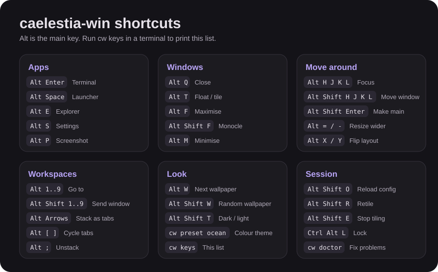

# Shortcuts and productivity guide

`Alt` is the main key. Press `cw keys` in a terminal to see this list any time, or open the [printable cheat sheet](assets/keybinds-cheatsheet.svg).



## caelestia-win shortcuts

| Group | Keys | Action |
|---|---|---|
| Apps | `Alt` `Enter` | Terminal |
| | `Alt` `Space` | Launcher (Flow Launcher) |
| | `Alt` `E` / `Alt` `B` | File Explorer / browser |
| | `Alt` `S` | Settings window (colours, wallpapers, gaps, bar, shortcuts) |
| | `Alt` `P` | Screenshot to `Pictures\caelestia-win-screenshots` |
| Windows | `Alt` `Q` | Close |
| | `Alt` `M` | Minimise |
| | `Alt` `T` | Float or tile |
| | `Alt` `F` | Maximise |
| | `Alt` `Shift` `F` | Monocle (one window fullscreen inside the tiler) |
| Focus | `Alt` `H` `J` `K` `L` | Left, down, up, right |
| Move | `Alt` `Shift` `H` `J` `K` `L` | Move window in that direction |
| | `Alt` `Shift` `Enter` | Promote to the main tile |
| Resize | `Alt` `=` / `Alt` `-` | Wider / narrower |
| | `Alt` `Shift` `=` / `Alt` `Shift` `-` | Taller / shorter |
| Layout | `Alt` `X` / `Alt` `Y` | Flip horizontally / vertically |
| Stacks | `Alt` `Arrows` | Merge window into a tabbed stack |
| | `Alt` `;` | Take window out of the stack |
| | `Alt` `[` / `Alt` `]` | Previous / next tab in stack |
| Workspaces | `Alt` `1`..`9` | Go to workspace |
| | `Alt` `Shift` `1`..`9` | Send window to workspace |
| Theme | `Alt` `W` | Next wallpaper and colours |
| | `Alt` `Shift` `W` | Random wallpaper |
| | `Alt` `Shift` `T` | Dark / light |
| | `Ctrl` `Alt` `W` | Next animated wallpaper |
| | `Ctrl` `Alt` `Shift` `W` | Stop the animated wallpaper |
| Session | `Alt` `Shift` `O` | Reload config |
| | `Alt` `Shift` `R` | Retile |
| | `Alt` `Shift` `E` | Stop tiling |
| | `Ctrl` `Alt` `L` | Lock |

## Windows shortcuts worth knowing (they still work)

| Keys | Action |
|---|---|
| `Win` `Shift` `S` | Screenshot a region |
| `Win` `V` | Clipboard history |
| `Win` `.` | Emoji picker |
| `Win` `Tab` | Task view |
| `Ctrl` `Shift` `Esc` | Task Manager |
| `Alt` `Tab` | Switch between apps |
| `Win` `L` | Lock |
| `Win` `I` | Settings |

## Windows Terminal

| Keys | Action |
|---|---|
| `Ctrl` `Shift` `T` | New tab |
| `Ctrl` `Shift` `D` | Duplicate tab |
| `Alt` `Shift` `D` | Split the pane (Windows Terminal default) |
| `Ctrl` `Shift` `P` | Command palette |

## Flow Launcher (`Alt` `Space`)

- Type an app name and press `Enter` to open it.
- Type `>` before a command to run it, a calculation like `12*8` to get an answer, a plain search to look up files.
- `Ctrl` `Enter` opens the folder of a result, `Shift` `Enter` shows its context menu.
- Open its settings to add plugins: web search, clipboard, window switcher, emoji.

## Five habits that make you fast

1. **One thing per workspace.** `Alt` `1` browser, `Alt` `2` code, `Alt` `3` chat, `Alt` `4` music. Jump with one chord instead of hunting windows.
2. **Never drag windows.** Open an app, it tiles itself. Use `Alt` `Shift` `H J K L` to rearrange.
3. **Launcher for everything.** `Alt` `Space`, three letters, `Enter`. Faster than the Start menu.
4. **Float only when needed.** Calculator, pop-ups and video calls often work best floating: `Alt` `T`.
5. **Stack to save space.** Many terminals? Stack them with `Alt` `Arrows` and cycle with `Alt` `[` and `]`.

## Make your own shortcut

Easiest: press `Alt` `S`, open the **Shortcuts** page, use **Add an app ...** or edit the table, then **Save shortcuts**.

By hand: open `~\.config\whkd\whkdrc` and add a line:

```text
alt + n : notepad.exe
```

Save, then press `Alt` `Shift` `O`. The format is always `keys : command`.

## Learning order

1. Day 1: `Alt` `Enter`, `Alt` `Q`, `Alt` `Space`, `Alt` `1`..`3`.
2. Day 2: `Alt` `H J K L` for focus.
3. Day 3: `Alt` `Shift` `H J K L` for moving, `Alt` `T` for float.
4. Week 2: stacks, resize, layout flips, presets.
